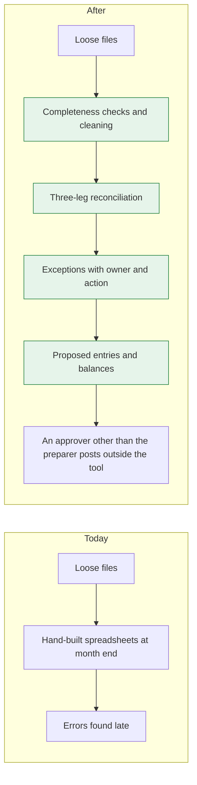
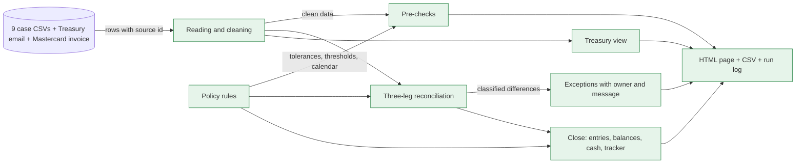

# Spec — Project Bridge: card reconciliation and September close

```yaml
id: project-bridge
project: clara-caso-finance (bundle personal)
lineage_ref: row "Reconciliation tool, Part 1" of the project board; scope approved by Andrés in session on 2026-10-14 (project decision log)
status: approved
approved_by: G-2026-10-15-03
approved_at: 2026-10-14 19:58
translated: 2026-10-14 — English translation at Andrés's request, no change in content; the approved Spanish text is commit 8a5a95f
repo: project-bridge
branch: feat/project-bridge
prd_flow: "Design: inputs first, then rules, then work" from the scope document (clara_caso_finance/entrega/01-PRD-lite.md)
```

# Part 1 — Readable in one pass

## What problem it solves, and for whom

September's card money sits in four records that do not agree: the processor (records every purchase), Mastercard
(settles one daily net in dollars), the bridge account (the USD bank account Mastercard debits that net from) and the
general ledger. Today the reconciliation is done by hand at month end and errors are found late. This tool reads the
case files, checks that they are complete, reconciles the three legs (processor vs Mastercard per transaction;
Mastercard daily net vs the bank debit; bridge account and Mastercard payable vs the ledger), classifies every
difference, proposes the closing journal entries and shows everything on one page the analyst opens with a double
click. Every figure carries its source row. Users: the Finance Ops analyst (works exceptions), the Controller (reviews
and approves entries) and Treasury (bank items and funding).

## How it is today, and how it ends up



## The pieces, and how they connect

Everything is new; the case files are never modified.



## How it works, step by step

```mermaid
sequenceDiagram
    autonumber
    participant A as Analyst
    participant H as Tool
    participant P as Page
    A->>H: runs the program on the data folder
    H->>H: reads and cleans; every row keeps file and line
    H->>H: pre-checks (missing days, totals, statuses, card numbers)
    alt an input is missing or a file cannot be read
        H-->>A: reports it as missing and continues with the rest; never estimates
    end
    H->>H: reconciles the three legs and classifies every difference
    H->>H: proposes entries, before and after balances, cash, close tracker
    H-->>P: writes the page, the CSVs and the run log
    A->>P: filters, drills down to the source row, assigns owner, status and comment
    A->>P: exports exceptions to CSV
    Note over A,P: Nothing is posted; whoever the amount requires approves outside the tool
```

## What it decides, and what it leaves out

- The minimum is what the case asks for (three legs, classification, filters, drill-down to source,
  owner/status/comment, export, entries, balances, cash, tracker) **plus the completeness checks before reconciling**,
  because they are success measure 3 of the scope document and the base of Andrés's design. Built first and complete.
- Then, in this order and only if there is time: predefined messages per exception type, Mastercard invoice broken
  down by line item, Treasury view (balance, days of coverage, suggested transfer).
- Out: live connections, shared state between analysts, posting, the question-answering assistant over the data
  (agent), product margin view.

## Questions for Andrés

None open. Answered on 2026-10-15: (1) the "after" balances go in two columns, "confirmed only" and "if the evidence
arrives"; (2) the USD 250 threshold is measured on the gross amount.

# Part 2 — Execution contract

## Decisions already made that this spec executes

All by Andrés in session on 2026-10-14, recorded in
the project decision log (`DECISION_LOG.md`, kept outside this repository):
a Python program (standard library only) that generates a single-file HTML page plus CSVs; a clean input model before
reconciling; FX rate = network rate (`fx_rates_daily.csv`); connections only written up; approval threshold read as
the entry's total debits; Mastercard invoice accrued by line item; Treasury view with an illustrative buffer; tests
with the verified figures before the tool; minimum first, extras after.
Policy rules, one by one: `clara_caso_finance/REGLAS-politica.md`. Verified figures:
the data findings note (`hallazgos-datos-2026-10-14.md`, kept outside this repository).

## Deliverables — index

| id | Name | What it is |
|---|---|---|
| E0 | Golden-figure tests | `tests/test_golden.py` — the verified figures, written before the code |
| E1 | Policy rules | `bridge/policy.py` — the single declaration of tolerances, thresholds, calendar, accounts |
| E2 | Reading and cleaning | `bridge/inputs.py` — loads CSVs with decimals and source id; normalises; types bank lines |
| E3 | Reconciliation | `bridge/recon.py` — three legs and classification |
| E4 | Close | `bridge/close.py` — proposed entries, before/after balances, cash, close tracker |
| E5 | Output | `bridge/report.py` + `run.py` — HTML page, CSVs and run log |
| E6 | Pre-checks | `bridge/checks.py` — completeness and anomalies, shown even when clean |
| E7 | Messages per exception type | table in `bridge/policy.py` — owner, action and message per type (extra 1) |
| E8 | Itemised invoice | in `bridge/close.py` — accrual by line item (extra 2) |
| E9 | Treasury view | `bridge/treasury.py` — balance, days of coverage, suggested transfer (extra 3) |

E0–E6 are the minimum; E7–E9 are built in that order afterwards. Without E8, the Mastercard invoice is accrued in a
single line for the total.

**Definitions every deliverable uses.** *Net* = `amount_usd − interchange_usd + scheme_fee_usd` (equal to Mastercard's
`net_settlement_usd`). *Gross* = `amount_usd`. *Cut-off date* for ageing and escalation: Monday 2026-10-05, working day
3 of the close (the close tracker's date), declared in `policy.py`, never the run date. *Country* = the customer's
`program_country`; for Mastercard-only rows, `merchant_country` flagged "merchant country". *Source* = (file, line)
for CSVs; (file, date and subject) for the Treasury email; (file, line item) for the invoice; a missing input has
source "missing: <what>".

## Design, deliverable by deliverable

### E0 — Golden-figure tests: `tests/test_golden.py`
`python3 -m unittest` over the data in `clara_caso_finance/insumos/datos/` (path via the `BRIDGE_DATA` environment
variable). Asserts the figures in the Verification section. Written, and failing, before E1–E5.

### E1 — Policy rules: `bridge/policy.py`
Constants and tables: per-transaction tolerance 0.05; per-day 1.00; explain ≥ 250; escalate unexplained > 1000;
escalate open > 5 working days; approval ≥ 10000 Controller, ≥ 100000 CFO, measured as total debits; cut-off date
2026-10-05; US bank holidays in the period (2026-09-07, 2026-10-12); account map (1110…6150, and 3900 as the opening
balancing figure); processor posting rules. No other module writes these values.

### E2 — Reading and cleaning: `bridge/inputs.py`
Every row keeps `src = (file, line)` (header = line 1). Amounts as `Decimal`. `network_ref` normalised: strip spaces
and hyphens, upper-case, valid if `^MC\d{13}$`. Only processor `CLEARED` rows carry money. Bank lines typed: Mastercard
settlement, Mastercard invoice, bank fee, Treasury funding, customer/unidentified receipt. Ledger entries grouped by
`je_id` and `reference`.

### E3 — Reconciliation: `bridge/recon.py`
- Leg 1, processor ↔ Mastercard: by normalised reference; if empty, by last 4 + currency + local amount + clearing
  date, accepted only if unique (otherwise exception "ambiguous match"). If two processor rows share a reference, the
  first by `txn_id` is the original and the rest are duplicates. Classification order for a matched pair (the first
  that applies): month cut-off (different clearing date) > sign flip (different sign of `amount_local`; never by
  `txn_type`) > local amount difference > FX rate difference. Unmatched rows are "processor only" or "Mastercard
  only". A difference ≤ 0.05 is rounding.
- Leg 2, Mastercard daily net ↔ bank debit on the next working day; duplicate by repeated `bank_reference`.
- Leg 3, bridge account and 2105 ↔ ledger: processor entry per clearing day (missing, different date); bank lines
  against bank entries; manual entries.
- Every difference: type, class, gross and net USD, sources, age in working days at the cut-off date, whether it
  requires explanation (gross ≥ 250) or escalates per E1. Escalation by age applies to every money difference on all
  three legs, aged from its origin date (clearing date for leg 1; the bank line or missing entry's date for legs 2
  and 3); data-issue flags carry no money and do not escalate by age. Type → class map, declared in `policy.py`:
  - *Timing*: month cut-off; processor entry with a different date; funding in transit; settlement not yet debited;
    suspense receipt with payer to be confirmed.
  - *Real error*: processor duplicate; duplicate bank debit; sign flip; amount difference; FX rate difference;
    processor only; Mastercard only; missing processor entry; invoice not accrued.
  - *Data issue*: empty or mistyped reference (even if matched); authorisation date after clearing date;
    authorisation older than 5 working days; ambiguous match; missing input.

### E4 — Close: `bridge/close.py`
Proposed entries, each balanced, with supporting rows, status `proposed` or `proposed-conditional` (with the missing
evidence), preparer and approver empty, and the required approval level. Closed list:
1. Missing processor entry for 24-Sep (from that day's cleared transactions).
2. Re-date to 30-Sep the processor entry for 30-Sep posted on 1-Oct (its October reversal does not affect 30-Sep
   balances).
3. Duplicate bank debit: Dr 1250 / Cr 2105 for 40,616.94.
4. C029 suspense: Dr 2900 / Cr 1210 for 12,500.00 — conditional on the bank receipt.
5. Mastercard invoice: Dr 5100 / Cr 2150 for 8,412.30 (by line item if E8 is built).
6. Correction of processor errors, one entry per type (rate, sign, amount, duplicates, processor only, Mastercard
   only), each against 1210/2105/4100/5100; the "processor only" one (9,127.92 net) conditional on processor
   confirmation.
30-Sep balances of the eleven accounts (including 3900, the opening balancing figure) before and after; "after" in two
columns labelled "confirmed only" (confirmed) and "if the evidence arrives" (confirmed plus conditional). Cash
reconciliation ledger ↔ bank with reconciling items. Close tracker from `close_checklist.csv` (CRLF line endings):
status, dependencies, blockers, critical path to period close, and which tasks the tool completes or evidences.

### E5 — Output: `bridge/report.py`, `run.py`
`python3 run.py --data <dir> --out <dir>` writes into `--out`: `index.html` (one file, data embedded, no external
dependencies), `exceptions.csv`, `proposed_entries.csv`, `balances.csv`, `cash_recon.csv`, `close_tracker.csv`,
`checks.csv`, `run_manifest.json` (SHA-256 fingerprint of every input file, code version = git commit, date and time,
totals; if the tree has uncommitted changes, the version carries the suffix `-dirty`). The page: summary by leg and
class; exceptions filterable by class, country, date and amount; drill-down to source rows of every file;
owner/status/comment saved in the browser (if the browser blocks saving on a local file, the page says so and export
keeps working); export CSV. Amounts are displayed from decimal text; the amount filter may compare JavaScript numbers
because it produces no figures.

### E6–E9 — Extras
E6 (minimum) pre-checks (summary vs detail per day with amount and count, clearing days vs entries, settlements vs
debits, the net formula, statuses, stale authorisations, impossible dates, card numbers, missing inputs such as the
processor invoice), each with a result even when clean, on the page and in `checks.csv`. E7 per exception type:
default owner, action, predefined message. E8 accrual of the invoice by line item with the variable/fixed
classification. E9 daily balance, working days of coverage, suggested weekly transfer flagged as illustrative.

## What must never happen

| # | Invariant | How we would know it broke |
|---|---|---|
| I1 | Every figure shown or exported carries at least one source (file, line) or is a sum of figures that do | An output row without `src` |
| I2 | Nothing is posted: every entry comes out as `proposed`, balanced, with the approval level per E1 | An entry with debits ≠ credits, or a status other than `proposed` |
| I3 | Only processor `CLEARED` rows add money | Processor totals ≠ 912,453.49 net for Sep |
| I4 | The processor–Mastercard difference is explained with zero residual | Sum of classes ≠ 15,600.17 |
| I5 | A fuzzy match (no reference) is accepted only if unique | A Mastercard row matched by the fuzzy rule to two processor rows |
| I6 | Money arithmetic in `Decimal` | A `float` in an amount |
| I7 | Policy values declared only in `bridge/policy.py` | Another module uses a tolerance, threshold or date without importing it from `policy` |
| I8 | Input files are not modified | An input's SHA-256 fingerprint changes after the run |
| I9 | A missing input is reported, never estimated | An amount without source for an absent input |
| I10 | No full card number in outputs | After normalising references (including the raw ones shown on drill-down), a 13–19 digit string remains that is not an `MC` reference |
| I11 | No proposed entry has the same preparer and approver | An approvable entry with preparer = approver |
| I12 | A conditional entry never appears as confirmed | An entry with missing evidence in the "confirmed only" column |

## Why this and not the alternative

| Decision | Closest alternative | Deciding criterion | Source of the criterion |
|---|---|---|---|
| Dependency-free Python + single-file HTML | Web app with a library (Streamlit) | The evaluator opens it without installing anything | Brief: "the smallest thing that works in production" |
| Policy rules in a single module | Constants in each step | A rule is declared once | Andrés's global CLAUDE.md, code standards (DRY) |
| Golden-figure tests before the code | Tests after | The already-verified figures stay protected | Andrés's decision, 2026-10-14 |
| Analyst state in the browser | Shared database | Fits in 3–4 hours; declared as a cut | Brief: time, and "tell us what you cut" |
| Fuzzy match only if unique | Best candidate by score | A wrong match contaminates traceable figures | Brief: "every number traceable" |
| Standard library, no pandas | pandas script that generates HTML | The evaluator runs `python3 run.py` without `pip install`; the volume (≈7k rows) does not need it | Brief: "the smallest thing that works" |
| Network rate | Each country's official rate | Policy requires billing at the network rate | `recon_and_close_policy.md`, accounting treatment |
| Approval threshold = total debits | Net P&L effect | A balanced entry sums to zero; total debits is the measure that leaves no large entry without an approver | Andrés's decision, 2026-10-14 |
| Conditional entries flagged separately | Sum them without a flag | Do not present the unconfirmed as fact | Brief: "every number traceable" |

## Out of scope

- Live connections to processor, Mastercard, bank, ledger and email — they go in the path-to-production note.
- Shared state between analysts — production note.
- Posting entries — never, by policy.
- Question-answering agent — only if time is left, with its own spec.
- Margin view by product, customer and country; target balance and cost of idle cash — written, not built.

## Files

Created: `run.py`, `bridge/__init__.py`, `bridge/policy.py`, `bridge/inputs.py`, `bridge/recon.py`,
`bridge/close.py`, `bridge/report.py`, `bridge/checks.py`, `bridge/treasury.py`, `bridge/template.html`,
`tests/test_golden.py`, `README.md` (how to run it). None is modified outside the repo. Data is read from
`clara_caso_finance/insumos/datos/` and never copied into the repo.

## End-to-end verification

`BRIDGE_DATA=<insumos/datos> python3 -m unittest -v` passes, and `python3 run.py --data <insumos/datos> --out
/tmp/bridge` produces the E5 files; `index.html` opens without network.

| # | Check | Invariant |
|---|---|---|
| V1 | Processor `CLEARED` net = 912,453.49 (3,117 rows); including authorised/declined would change it (gross cleared 924,303.45); Mastercard Sep = 896,853.32 (3,109) | I3 |
| V2 | Leg 1 classes: sign 2,502.45; amount 737.29; rate 751.93; duplicates 3,593.63; processor only 9,127.92; Mastercard only −2,041.36; cut-off 928.31; sum 15,600.17 | I4 |
| V3 | Mastercard rows matched 3,108 (3,003 by exact reference + 45 normalised + 60 fuzzy; includes 4 cut-off rows clearing in October); processor rows matched 3,114 (6 are duplicates); no repeated fuzzy match | I5 |
| V4 | Leg 2: the only break is BS0018 (40,616.94, reference BNK324320124); the 2-Oct settlement pending (33,163.52) | I1 |
| V5 | Leg 3: processor entry for 24-Sep missing (net 44,884.41); the 30-Sep one dated 1-Oct (45,331.47) | I1 |
| V6 | Ledger balances 30-Sep (eleven accounts): 1110 1,547,965.55; 1210 4,245,795.36; 1250 0; 2105 +70,588.66; 2150 0; 2300 −6,100,000.00; 2900 −12,500.00; 4100 −13,571.56; 5100 2,894.36; 6150 465.00; 3900 +258,362.63; sum of all = 0 | I1 |
| V7 | After, confirmed plus conditional: 1210 4,309,799.60; 1250 40,616.94; 2105 −45,572.30; 2150 −8,412.30; 2900 0.00; 4100 −14,828.29; 5100 11,603.17; rest unchanged; sum = 0 | I2 |
| V7b | After, confirmed only: 1210 4,331,559.00; 1250 40,616.94; 2105 −54,700.22; 2150 −8,412.30; 2900 −12,500.00; 4100 −14,971.81; 5100 11,615.21; rest unchanged; sum = 0 | I12 |
| V8 | Every proposed entry balanced, in `proposed` or `proposed-conditional`, with approval level by total debits; none approvable with preparer = approver | I2, I11 |
| V8b | PX10002115 flagged "requires explanation" (gross 253.05; net 249.45) | I1 |
| V8c | Escalate by age at the cut-off date: duplicate debit (10 working days), C029 suspense (8), missing 24-Sep processor entry (7), and every leg-1 money difference older than 5 working days (by type: sign 3 of 4, amount 8 of 8, duplicates 5 of 6, processor only 3 of 3, Mastercard only 4 of 5, stale rate 95 of 95, cut-off 0 of 4) | I7 |
| V9 | Cash: ledger 1,547,965.55 − 400,000.00 in transit (BS0032) = bank 1,147,965.55 | I1 |
| V10 | Every row of every output CSV with a non-empty `src`; no `float` in the Python modules that touch amounts; no module other than `policy.py` defines policy constants (import review) | I1, I6, I7 |
| V11 | Input fingerprints equal before and after the run | I8 |
| V12 | Processor invoice reported as a missing input | I9 |
| V13 | No 13–19 digit string outside `MC` references in the outputs, after normalising the raw ones | I10 |
| V14 | Manual demo in Chrome with `index.html` opened as a file: filter by class, country, date and amount; drill down to the source row of every file; assign owner, status and comment, reload and see them; export CSV | I1 |

## Decision log

- 2026-10-14 — initial draft from the conversation with Andrés. decided: the session, within the approved scope.
- 2026-10-15 — critical review in fresh context (brief B-2026-10-15-02): 9 material and 9 minor findings; every
  individual figure recomputed and correct. Fixed: balances with the eleven accounts; closed list of entries and
  conditional status; definitions of net, gross, cut-off date, country and source; fuzzy rule vs duplicates; card
  number detector after normalising; completeness checks move into the minimum (a mandatory test and success measure
  3 required it); type → class map; manual page test; missing justifications. Left for Andrés: "after" columns and
  the measure of the 250 threshold. decided: the session.
- 2026-10-15 — Andrés answers: two "after" columns; 250 threshold on gross. Approves the spec. decided: Andrés, in
  session.
- 2026-10-14 — translated to English at Andrés's request ("todo lo que hagas hazlo en inglés, la spec también"); no
  change in content. decided: Andrés, in session.
- 2026-10-14 — escalation by age widened to every money difference on all three legs, as the policy reads ("open
  reconciling items older than 5 business days"); found by the test-building agent, measured by the session.
  decided: Andrés, in session («Si porf» [Yes please]).
